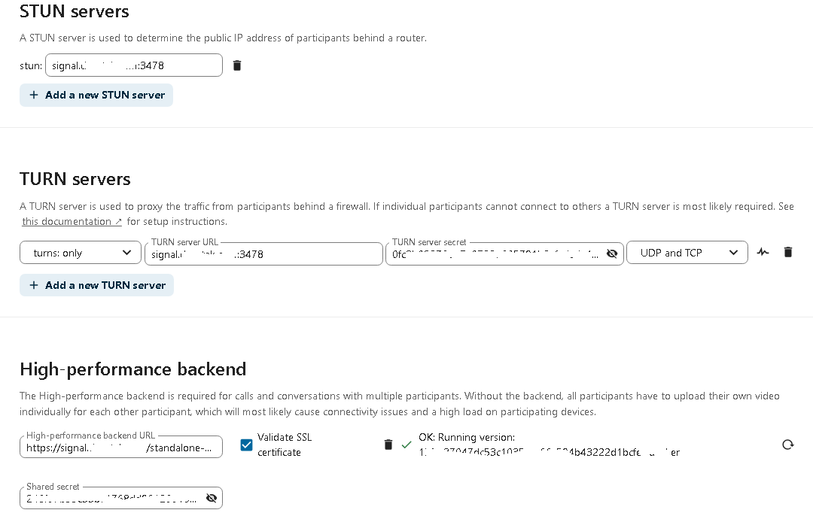

## About

Spreed standalone signaling server for Nextcloud.

For more information please visit [https://github.com/strukturag/nextcloud-spreed-signaling](https://github.com/strukturag/nextcloud-spreed-signaling).

Original Credit and Inspiration: [MARKUS WEINGÄRTNER](https://markus-blog.de/index.php/2020/11/20/how-to-run-nextcloud-talk-high-performance-backend-with-stun-turnserver-on-ubuntu-with-docker-compose/)

## General Requirements

Spreed standalone signaling server requires a fully updated Linux machine with the Docker engine and the **docker compose plugin** (not the legacy `docker-compose` binary) installed, as well as a fully functioning Nextcloud installation.

The installation script also needs `git`, `curl` and `openssl`. It uses them if they are already present, and otherwise installs them with whichever of `apt-get`, `dnf`, `yum`, `zypper`, `pacman` or `apk` is available. If none is found it tells you what to install and exits.


## Prerequisites

The installation script will prompt you for the following information. Ensure you have the following information available **BEFORE** running the script:

- **Nextcloud-Signal FQDN** The full name you wish to use for Nextcloud-Signal (Example: signal.domain.tld).
- **Nextcloud Instance URL** This is the FQDN URL of a Nextcloud server instance that will be connecting to the Nextcloud-Signal server. You **MUST** include http:// or https:// (Example: https://cloud.domain.tld). If you omit the scheme the script offers to add `https://` rather than accepting a value the signaling server cannot use.
- **Public IP address** The public IP address of this server. This is advertised to clients in ICE candidates and TURN relay addresses. The script offers the address the Nextcloud-Signal FQDN resolves to as the default, which on a host with several public addresses is the correct one by definition. If the server is behind 1:1 NAT, enter the public side of the NAT.
- **Bind IP address** (optional) If the server has multiple public IP addresses, the script can bind all published ports to a single one, so the stack does not claim ports on the others. The script verifies the address is actually configured on an interface before proceeding.

## Firewall Ports

The following ports must be open. The two UDP ranges are required for media to flow; without them calls connect and then drop.

| Port | Protocol | Purpose |
| --- | --- | --- |
| 80 | tcp | Let's Encrypt http-01 challenges, redirect to HTTPS |
| 443 | tcp | Signaling websocket and API |
| 3478 | tcp + udp | STUN / TURN |
| 5349 | tcp + udp | TURN over TLS (`turns:`) |
| 20000-20099 | udp | Janus media (RTP/RTCP) |
| 49160-49200 | udp | Coturn relay |

The UDP ranges are configurable in `/opt/nextcloud-spreed-signaling/.env` via `JANUS_RTP_MIN`/`JANUS_RTP_MAX` and `TURN_RELAY_MIN`/`TURN_RELAY_MAX`. Roughly one port is used per media stream, so ~100 ports covers a small deployment.

## DNS

The Nextcloud-Signal FQDN must resolve to this server before you run the installation, because the Let's Encrypt http-01 challenge connects to whatever DNS returns.

If you bound published ports to a specific IP (see **Bind IP address** above), the FQDN must resolve to **that exact address**. Ports listen only on the bound address, so if DNS points at any other IP on the host, nothing is listening and certificate issuance fails. Verify both before requesting a certificate:

```
dig +short signal.domain.tld
ss -lntp | grep ':80'
```

The address returned by `dig` and the address in the `ss` output must match.

## Installation

Clone the deeztek-docker repository with git:

```
sudo git clone https://github.com/deeztek/deeztek-docker.git
```

This will clone the repository and create a docker directory in the directory you ran the git clone command from.

Change to the nextcloud-spreed-signaling directory:

```
cd deeztek-docker/Linux/nextcloud-spreed-signaling
```

Run the following script as root:

```
sudo bash install_nextcloud_signal.sh
```

The script will create a **/opt/nextcloud-spreed-signaling/** directory and configure all necessary directories and files under that directory.

It will automatically generate the following random variables and insert those variables in the appropriate configuration files (server.conf, .env, default.conf):

* Static Secret
* Hash Key
* Block Key
* Shared Secret
* Api Key
* Internal Shared Secret

At the end of the run it prints the values needed to configure Nextcloud, along with the firewall ports to open. Take note of them:

* Static Secret (the TURN secret)
* Shared Secret (the high-performance backend secret)

It will build and deploy the following six containers:

* nextcloud_spreed_nginx
* nextcloud_spreed_backend
* nextcloud_spreed_janus
* nextcloud_spreed_coturn
* nextcloud_spreed_nats
* nextcloud_spreed_cron (ofelia, runs the certificate renewal job)

Only the Janus image is built from source; everything else uses a prebuilt, version-pinned image. The upstream repository is cloned to **/opt/nextcloud-spreed-signaling/** at the release tag matching the signaling server image, because the Janus 1.3.0 image is built from `docker/janus` in that repository and there is no published Janus 1.x image upstream.

## Let's Encrypt Certificates

The installation script automatically configures a scheduled cron job to renew Lets Encrypt Certificates on a daily basis.

By default, the script will launch Nginx reverse proxy with a self-signed certificate. If you wish to leverage a Lets Encrypt certificate, ensure that BOTH ports 80/TCP and 443/TCP are open to the Internet and that the **Nextcloud-Signal FQDN** you specified during installation points to the public IP of your Nextcloud-Signal instance.

Both certificate scripts read the Nextcloud-Signal FQDN from `/opt/nextcloud-spreed-signaling/.env` and ask you to confirm it, rather than having you retype it. They also warn if that name does not appear in the deployed nginx configuration, since a certificate issued under a name nginx is not serving would leave nginx unable to start.

Before attempting to get a production Lets Encrypt certificate, you should test with the Lets Encrypt Staging environment first by running the following script:

```
sudo bash certbot_certificate_staging.sh
```

The script asks you to agree to the Lets Encrypt Terms of Service and for an e-mail address for expiry notices, then runs certbot non-interactively. If it all goes well, it will output the following indicating success:

```
...
The dry run was successful.
...
```

If succesful, you can now safely run the following script to get a production Lets Encrypt Certificate:

```
sudo bash certbot_certificate_production.sh
```

The script asks you to agree to the Lets Encrypt Terms of Service and for an e-mail address for expiry notices, then runs certbot non-interactively. If it all goes well, it will output the following indicating success:

```
....
Successfully received certificate.
....
```

## Connect Nextcloud to Nextcloud-Signal

Login to Nextcloud as an Administrator and add and enable the **Nextcloud Talk** app. 

Next navigate to **Settings --> Administration --> Talk**. 

In the **STUN servers** section, enter the FQDN of your Nextcloud-Signal instance on port **3478** (Example: signal.domain.tld:3478).

In the **TURN servers** section, select **turns: only** on the drop-down and enter the FQDN of your Nextcloud-Signal instance on port **5349** (Example: signal.domain.tld:5349), then enter the **Static Secret** variable that was output earlier into the **secret** field.

> Use port **5349** for `turns:`, not 3478. Coturn's `--tls-listening-port` defaults to 5349; port 3478 is the plaintext STUN/TURN listener. Pointing a `turns:` URL at 3478 fails silently, and TURN then never works at all.

In the High-performance backend section, click the + button and enter **https://signal.domain.tld/standalone-signaling/** where **signal.domain.tld** is tha actual FQDN of your Nextcloud-Signal instance and in the **Shared secret** field enter the **Shared Secret** variable that was output ealier (**Figure 1**):

**Figure 1**



## Upgrading

Run the upgrade script as root. It will prompt for the release to upgrade to (see the [upstream releases](https://github.com/strukturag/nextcloud-spreed-signaling/releases)):

```
sudo bash upgrade_nextcloud_signal.sh
```

The script stops the stack, checks out the requested release tag, updates the signaling server image tag in **docker-compose.yml**, rebuilds the Janus image, pulls the new images and brings everything back up. Your local `server.conf`, `.env`, `docker-compose.yml`, `nginx/`, `certbot/`, `coturn/` and `scripts/` are all listed in `.gitignore`, so the checkout does not disturb them.

## Notes on media connectivity

Two settings in `.env` determine whether calls actually connect, and they are distinct:

- **`PUBLIC_IP`** is *advertised* to clients. Janus uses it for `--nat-1-1` and coturn for `--external-ip`. Without it, both advertise their container addresses (172.x.y.z), which no remote client can reach. Calls then either fail outright or connect and drop unpredictably.
- **`BIND_IP`** is the host address published ports *listen* on. This is optional: the installer asks whether you need it, and only writes it if you say yes. If you publish on all interfaces, the `${BIND_IP}:` prefix is stripped from every port mapping and the variable is removed from `.env`, so you get plain `"80:80"` mappings rather than an assumed `0.0.0.0:80:80`.

On a server with a directly attached public IP, `PUBLIC_IP` and `BIND_IP` are the same value. Behind 1:1 NAT, `PUBLIC_IP` is the public side and `BIND_IP` is the local interface.

To change the binding after installation, edit the `ports:` entries in `/opt/nextcloud-spreed-signaling/docker-compose.yml` and run `docker compose up -d`.

Do not point Janus at the local coturn with `--stun-server`. Coturn is on the same Docker network, so the STUN Binding response returns Janus's own container address; the resulting candidate is discarded and nothing is fixed.


